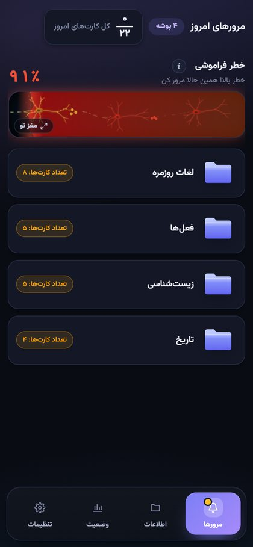
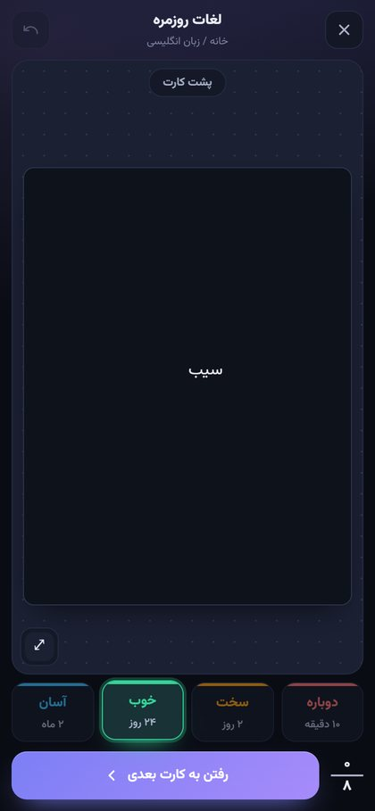
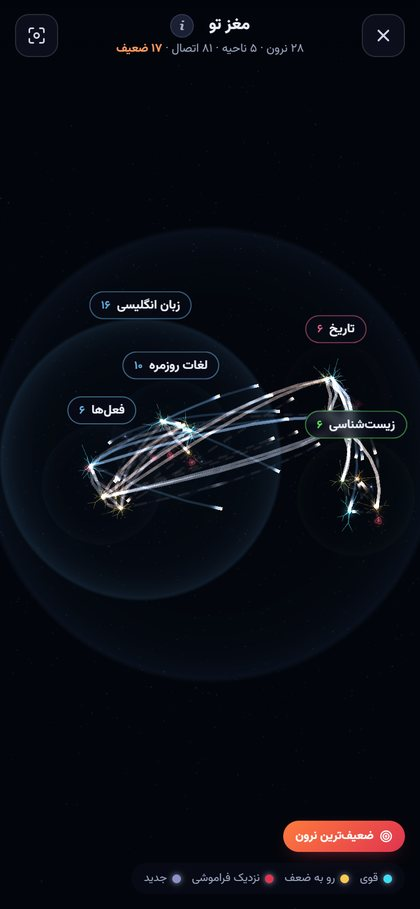

# یادآور

**مرور فاصله‌دار به فارسی، ساده و زیبا، روی گوشی**

با موتور متن‌باز انکی کار می‌کند و حافظه‌ات را به شکل یک مغز سه‌بعدی نشان می‌دهد

 

&nbsp;
&nbsp;
&nbsp;

## چرا یادآور؟

- **ساده و فارسی:** پوشه بساز، کارت بساز، هر روز چند دقیقه مرور کن. همه‌چیز راست‌به‌چپ و برای انگشت طراحی شده.
- **زمان‌بندی دقیق انکی:** همان الگوریتم‌های انکی (FSRS و SM-2)، بدون هیچ تغییری، داخل خود برنامه اجرا می‌شوند.
- **نوار خطر فراموشی:** یک نگاه کافی است تا بفهمی امروز چقدر از یادگرفته‌هایت در خطر است.
- **مغز تو:** هر کارت یک نرون است و هر پوشه یک ناحیه‌ی مغز. نرون‌های قوی می‌درخشند و ضعیف‌ها کم‌سو می‌شوند. با یک دکمه می‌روی سراغ ضعیف‌ترین‌شان.
- **کارت آزاد:** متن، عکس و صدای ضبط‌شده را هر جای کارت که خواستی بگذار.
- **بی‌اینترنت و خصوصی:** هیچ حساب کاربری و هیچ سروری لازم نیست. داده‌هایت فقط روی گوشی خودت می‌ماند و هر وقت خواستی از آن پشتیبان می‌گیری.
- **ورود از انکی:** پشتیبان `.colpkg` انکی را وارد کن و از همان‌جا ادامه بده.

## نصب

1. آخرین نسخه را از [صفحه‌ی دانلود](https://github.com/Mohammad13854224/yadavar/releases/latest) بگیر (فایل `yadavar.apk`).
2. روی گوشی بازش کن و اجازه‌ی نصب را بده.
3. نسخه‌های بعدی روی همین نسخه نصب می‌شوند و داده‌هایت سر جایش می‌ماند.

اندروید ۷ به بالا.

## سپاس و مجوز

یادآور روی [انکی](https://apps.ankiweb.net) ساخته شده، از طریق [موتور اندرویدی AnkiDroid](https://github.com/ankidroid/Anki-Android-Backend). از سازندگان هر دو سپاسگزاریم.

کد یادآور با مجوز [GNU AGPL-3.0](LICENSE) منتشر شده است، همان مجوز انکی.

> یادآور یک پروژه‌ی مستقل و غیررسمی است و هیچ وابستگی‌ای به انکی، Ankitects Pty Ltd یا AnkiDroid ندارد و از طرف آن‌ها تأیید نشده است. «Anki» نشان تجاری Ankitects Pty Ltd است.

---

<b>Yadavar</b>: a simple Persian spaced-repetition app for Android, powered by the open-source Anki engine. Not affiliated with Anki or Ankitects.

